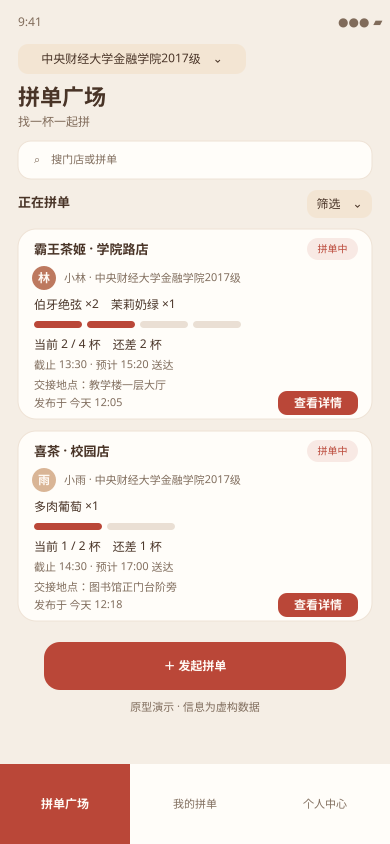

# 茶搭子｜产品作品集

**茶搭子——基于组织关系的茶咖拼单小程序 / APP**  
项目主理人：vivianwang  
联系方式：wv199959@gmail.com / wechat：vvv_0509

## 项目背景

一个人点奶茶，常常凑不够优惠或配送门槛；临时找同学、同事拼单又容易遇到沟通低效、商品对不上、付款和交接说不清等问题。和完全陌生的人拼单，也会让协作多一层顾虑。

「茶搭子」希望从学校、班级和企业等共同组织关系出发，让有相近需求的人更容易发现彼此。参与者可以在决定加入前查看商品、拼单进度、截止时间和交接地点；发起人也能向参与成员说明需求变化并跟进履约。拼单还为成员认识组织内不太熟悉的人提供轻量场景，带来社交破圈的附加价值。

## 页面示意

> 本站是产品设计与交互原型展示，不是已上线的真实拼单服务。第二、三阶段中的积分和社区功能属于未来构想。

## 在线预览

作品集在线地址：

- 中文：`https://wv199959-gif.github.io/teamate/`
- English：`https://wv199959-gif.github.io/teamate/en.html`

## 本地预览

1. 安装 Node.js（建议使用当前 LTS 版本）。
2. 在本项目文件夹打开终端。
3. 运行 `npm install` 安装依赖。
4. 运行 `npm run dev`，按终端显示的本地地址打开网页。
5. 运行 `npm run build` 可生成发布文件到 `dist/`。

## 技术说明

- React + Vite：构建中英文页面。
- Lenis：平滑滚动。
- GSAP：页面进入动效。
- SplitText：首屏文字动效组件，来源及依赖信息见 `src/components/SplitText.jsx`。

## 作品与使用说明

作品集中的产品构想、文案、页面编排和原创界面表达归作者所有。除 GitHub 平台为展示和托管所需的权限外，本仓库**未授予他人复制、修改、分发或商业使用作品内容的许可**。如需使用，请先联系作者取得书面许可。仓库不包含完整 PRD、微信小程序业务源码、密钥或真实用户数据。

依赖库和第三方素材仍适用各自的许可条款；具体依赖版本见 `package.json` 与 `package-lock.json`。

## 联系方式

- Email：wv199959@gmail.com
- WeChat：vvv_0509

